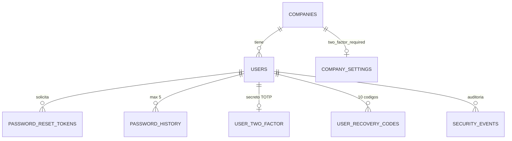
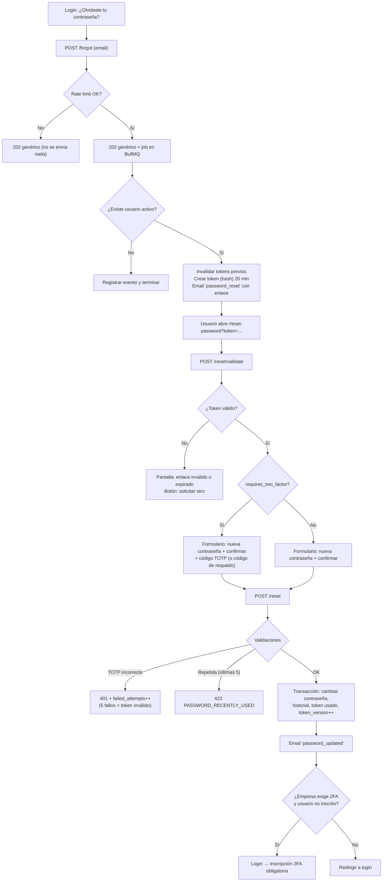
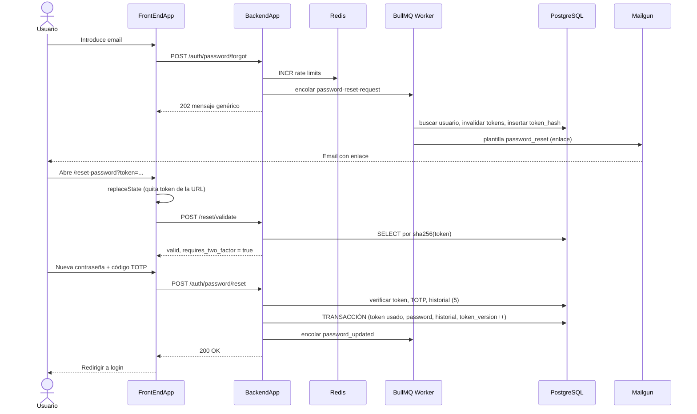
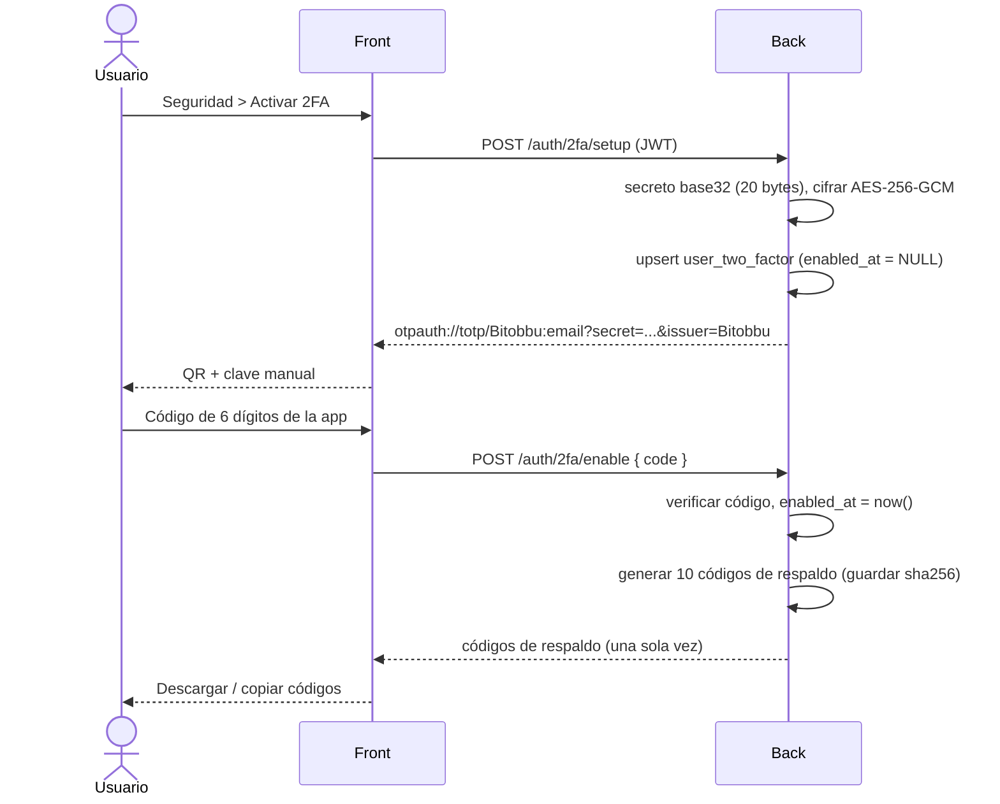

# Plan: Recuperación de contraseña + 2FA (TOTP) + Historial de contraseñas

> **Proyecto:** Bitobbu — `BackendApp` (Fastify + Prisma + PostgreSQL) / `FrontEndApp`
> **Estado:** Propuesta de diseño revisada contra el código (no implementado) — ver §15
> **Fecha:** 2026-10-22

---

## 1. Objetivo

Permitir que un usuario de una empresa recupere su contraseña de forma segura mediante un **enlace con token opaco de un solo uso** enviado por correo, exigiendo además un **código TOTP** cuando el usuario tiene 2FA activo (o la empresa lo exige), e impidiendo reutilizar cualquiera de las **últimas 5 contraseñas**.

## 2. Estado actual del código (hallazgos)

| # | Hallazgo | Archivo | Riesgo |
|---|----------|---------|--------|
| 1 | `ResetPasswordUseCase` cambia la contraseña **solo con el email**, sin token. La ruta está comentada, pero el caso de uso existe. | `src/modules/users/application/resetPasswordUseCase.ts` | 🔴 Crítico si se reactiva → **eliminar/reemplazar** |
| 2 | El login lanza `UserNotFoundError` si el email no existe → permite **enumerar usuarios**. | `loginUserUseCase.ts` L42 | 🟠 Alto → devolver siempre `InvalidCredentialsError` |
| 3 | `JWT_SECRET` tiene fallback `'fallback_secret'`. | `shared/application/services/jwtService.ts` L18 | 🟠 Alto → fallar al arrancar si no existe |
| 4 | Los JWT (1h) no se pueden revocar: tras cambiar la contraseña, las sesiones robadas siguen vivas. | `jwtService.ts`, `authMiddleware.ts` | 🟠 Alto → `token_version` |
| 5 | Política de contraseña solo alfanumérica (`[a-zA-Z0-9]+`) → **prohíbe símbolos**, reduce entropía. | `changePasswordUseCase.ts`, `resetPasswordUseCase.ts` | 🟡 Medio → permitir símbolos |
| 6 | Ya existen plantillas Mailgun `password_reset`, `password_updated`, `otp_verification`. | `shared/constants/email/email.constants.ts` | ✅ Reutilizar |
| 7 | Ya existen Redis (`ioredis`) y BullMQ (`queue/notifications`). | `shared/infrastructure/redis.ts`, `queue/` | ✅ Reutilizar para rate limit y envío async |
| 8 | `bcrypt` con cost 10 en varios sitios, duplicado. | users/admins use cases | 🟡 Centralizar en `PasswordHasher` (cost 12) |

## 3. Decisiones de diseño

| Decisión | Elección | Motivo |
|----------|----------|--------|
| Canal de recuperación | **Enlace con token opaco** (no OTP de 6 dígitos) | 256 bits de entropía, no se puede adivinar probando; estándar de la industria (GitHub, Stripe, AWS). |
| Formato del token | `crypto.randomBytes(32)` en base64url, **guardado como SHA-256** | Un JWT no se puede marcar como usado ni revocar sin BD; el hash evita que una filtración de la BD permita resets. |
| Vida del token | **20 minutos**, un solo uso | Balance entre usabilidad y exposición. |
| Segundo factor | **TOTP** (RFC 6238, app autenticadora) + **códigos de respaldo** | No depende del correo: si el correo está comprometido, el atacante no puede completar el reset. |
| Política 2FA | A nivel **empresa** (`two_factor_required`) + inscripción a nivel **usuario** | La empresa decide si es obligatorio; cada usuario tiene su propio secreto. |
| Historial | Bloquear la **actual + 4 anteriores = últimas 5** | Requisito del negocio. |
| Revocación de sesiones | `users.token_version` incluido en el JWT (`tv`), **leído de la consulta que el `authMiddleware` ya hace** | Al cambiar contraseña se incrementa → todos los JWT anteriores quedan inválidos. Sin caché en Redis (ver §15.2). |
| Rate limiting | **Redis** (no tablas) | Contadores efímeros con TTL. |
| Envío de correos | **BullMQ** (async) | La respuesta de `/forgot` tarda lo mismo exista o no el email (evita timing attacks). |

### 3.1 Matriz: ¿cuándo se pide TOTP en el reset?

| `company.two_factor_required` | Usuario tiene TOTP activo | ¿Se pide TOTP al restablecer? | Después del reset |
|---|---|---|---|
| ❌ No | ❌ No | No (solo enlace por email) | Login normal |
| ❌ No | ✅ Sí | **Sí** (TOTP o código de respaldo) | Login normal con 2FA |
| ✅ Sí | ✅ Sí | **Sí** (TOTP o código de respaldo) | Login normal con 2FA |
| ✅ Sí | ❌ No (aún no inscrito) | No se puede (no hay factor que verificar) → solo email | **Inscripción 2FA obligatoria** en el siguiente login antes de acceder |

> [!IMPORTANT]
> La regla es: **si el usuario tiene TOTP activo, siempre se exige**, independientemente de la política de la empresa. La política de empresa solo obliga a **inscribirse**; no puede verificar un factor que el usuario todavía no tiene.

---

## 4. Modelo de datos (Prisma / PostgreSQL)

Convenciones del proyecto respetadas: modelos en PascalCase, columnas `snake_case`, `@@map` en plural, UUID con `gen_random_uuid()`, `Timestamptz(6)`.

### 4.1 Cambios en tablas existentes

```prisma
model User {
  // ... campos existentes ...
  token_version        Int       @default(0)                     // NUEVO: se incrementa al cambiar contraseña / desactivar 2FA
  password_changed_at  DateTime? @db.Timestamptz(6)              // NUEVO: auditoría y UI ("cambiada hace 3 días")

  // NUEVAS relaciones
  password_reset_tokens PasswordResetToken[]
  password_history      PasswordHistory[]
  two_factor            UserTwoFactor?
  recovery_codes        UserRecoveryCode[]
  security_events       SecurityEvent[]
}

model CompanySettings {
  // ... campos existentes ...
  two_factor_required  Boolean   @default(false)                 // NUEVO: la empresa exige 2FA a todos sus usuarios
}
```

> [!NOTE]
> La columna `users.salt` (Int) es redundante: bcrypt incluye la sal y el cost dentro del hash. Se puede mantener por compatibilidad y deprecar más adelante.

### 4.2 `password_reset_tokens` — tokens de recuperación

```prisma
model PasswordResetToken {
  id               String    @id @default(dbgenerated("gen_random_uuid()")) @db.Uuid
  user_id          String    @db.Uuid
  token_hash       String    @unique @db.Char(64)              // SHA-256 hex del token enviado por email
  expires_at       DateTime  @db.Timestamptz(6)                // created_at + 20 min
  used_at          DateTime? @db.Timestamptz(6)                // se rellena al consumirlo
  invalidated_at   DateTime? @db.Timestamptz(6)                // revocado por un token más nuevo o por cambio de contraseña
  failed_attempts  Int       @default(0) @db.SmallInt          // intentos fallidos de TOTP con este token (máx. 5)
  requested_ip     String?   @db.VarChar(45)                   // IPv4/IPv6
  requested_ua     String?   @db.VarChar(255)
  created_at       DateTime  @default(now()) @db.Timestamptz(6)
  user             User      @relation(fields: [user_id], references: [id], onDelete: Cascade)

  @@index([user_id, created_at])
  @@index([expires_at])                                         // para el job de limpieza
  @@map("password_reset_tokens")
}
```

**Un token es válido si:** `used_at IS NULL AND invalidated_at IS NULL AND expires_at > now() AND failed_attempts < 5`.

### 4.3 `password_history` — últimas 5 contraseñas

```prisma
model PasswordHistory {
  id             String   @id @default(dbgenerated("gen_random_uuid()")) @db.Uuid
  user_id        String   @db.Uuid
  password_hash  String   @db.VarChar(255)                    // hash bcrypt (nunca texto plano)
  created_at     DateTime @default(now()) @db.Timestamptz(6)
  user           User     @relation(fields: [user_id], references: [id], onDelete: Cascade)

  @@index([user_id, created_at(sort: Desc)])
  @@map("password_history")
}
```

**Reglas:**
- Contiene la contraseña **actual** y las anteriores; se conservan **como máximo 5 filas por usuario**.
- Al registrar un usuario → se inserta su primera contraseña.
- Al cambiar/restablecer → se compara la nueva contraseña con `bcrypt.compare` contra las 5 filas; si coincide con alguna → `PASSWORD_RECENTLY_USED`.
- Tras insertar la nueva → se borran las filas que excedan las 5 más recientes (misma transacción).
- **Backfill inicial** (el proyecto aplica el schema con `prisma db push`; el SQL va en `prisma/seeds/`, idempotente): poblar con `INSERT INTO password_history (user_id, password_hash) SELECT id, password FROM users;`

### 4.4 `user_two_factor` — secreto TOTP del usuario

```prisma
model UserTwoFactor {
  user_id            String    @id @db.Uuid
  secret_ciphertext  String                                    // secreto base32 cifrado con AES-256-GCM
  secret_iv          String    @db.VarChar(32)                 // IV (12 bytes, hex)
  secret_tag         String    @db.VarChar(32)                 // auth tag GCM (16 bytes, hex)
  key_version        Int       @default(1) @db.SmallInt        // versión de TWO_FACTOR_ENC_KEY, permite rotar la clave
  enabled_at         DateTime? @db.Timestamptz(6)              // NULL = inscripción iniciada pero no confirmada
  last_used_step     BigInt?                                   // último time-step TOTP aceptado (anti-replay)
  created_at         DateTime  @default(now()) @db.Timestamptz(6)
  updated_at         DateTime  @updatedAt @db.Timestamptz(6)
  user               User      @relation(fields: [user_id], references: [id], onDelete: Cascade)

  @@map("user_two_factor")
}
```

> [!CAUTION]
> El secreto TOTP **no puede hashearse** (hay que leerlo para calcular el código), por eso se **cifra** con una clave de entorno `TWO_FACTOR_ENC_KEY` (32 bytes). Nunca guardarlo en texto plano ni devolverlo en ninguna API después de la inscripción.

**"Usuario tiene 2FA activo"** ⇔ existe fila con `enabled_at IS NOT NULL`.

### 4.5 `user_recovery_codes` — códigos de respaldo

```prisma
model UserRecoveryCode {
  id          String    @id @default(dbgenerated("gen_random_uuid()")) @db.Uuid
  user_id     String    @db.Uuid
  code_hash   String    @db.Char(64)                          // SHA-256 del código (alta entropía → no requiere bcrypt)
  used_at     DateTime? @db.Timestamptz(6)
  created_at  DateTime  @default(now()) @db.Timestamptz(6)
  user        User      @relation(fields: [user_id], references: [id], onDelete: Cascade)

  @@index([user_id])
  @@map("user_recovery_codes")
}
```

- Se generan **10 códigos** de formato `XXXXX-XXXXX` (≈50 bits) al activar 2FA; se muestran **una sola vez**.
- Regenerarlos borra los anteriores.
- Sirven para **login** y para **reset** si el usuario perdió el teléfono.

### 4.6 `security_events` — auditoría de seguridad

```prisma
model SecurityEvent {
  id          String            @id @default(dbgenerated("gen_random_uuid()")) @db.Uuid
  user_id     String?           @db.Uuid                      // NULL si el email no existía (forgot con email desconocido)
  company_id  String?           @db.Uuid
  event_type  SecurityEventType
  ip          String?           @db.VarChar(45)
  user_agent  String?           @db.VarChar(255)
  metadata    Json?                                           // nunca guardar tokens, códigos ni contraseñas
  created_at  DateTime          @default(now()) @db.Timestamptz(6)
  user        User?             @relation(fields: [user_id], references: [id], onDelete: SetNull)

  @@index([user_id, created_at(sort: Desc)])
  @@index([event_type, created_at])
  @@map("security_events")
}

enum SecurityEventType {
  password_reset_requested
  password_reset_completed
  password_reset_failed          // token inválido/expirado, TOTP incorrecto
  password_changed
  password_reuse_rejected
  two_factor_enrolled
  two_factor_disabled
  two_factor_failed
  recovery_code_used
  recovery_codes_regenerated
  login_failed
  login_locked
}
```

### 4.7 Diagrama entidad-relación



### 4.8 Datos efímeros en Redis (sin tabla)

| Clave | TTL | Uso |
|-------|-----|-----|
| `rl:forgot:email:{sha256(email)}` | 1 h | Máx. **3** solicitudes de reset por email/hora |
| `rl:forgot:ip:{ip}` | 1 h | Máx. **10** solicitudes por IP/hora |
| `rl:reset:ip:{ip}` | 15 min | Máx. **20** intentos de `POST /reset` por IP |
| `rl:login:{sha256(email)}:{ip}` | 15 min | Máx. **5** logins fallidos por (email, IP) → bloqueo temporal de esa combinación (no del email global, ver §15.2) |
| `rl:login:ip:{ip}` | 15 min | Máx. **30** logins fallidos por IP |
| `rl:totp:user:{user_id}` | 1 h | Máx. **10** fallos de TOTP/código de respaldo por usuario, **sumando todos los tokens y el login** (§15.1) |

---

## 5. Endpoints (API)

Prefijo propuesto: `/auth/password` (módulo nuevo `src/modules/auth`) — o bajo `/users` si se prefiere mantener todo en el módulo actual.

| Método | Ruta | Auth | Descripción |
|--------|------|------|-------------|
| `POST` | `/auth/password/forgot` | Pública | Solicita el enlace. **Siempre** responde `202` con mensaje genérico. |
| `POST` | `/auth/password/reset/validate` | Pública | Comprueba el token **sin consumirlo**. Devuelve si requiere 2FA. |
| `POST` | `/auth/password/reset` | Pública | Consume el token, verifica TOTP si aplica, cambia la contraseña. |
| `POST` | `/users/change-password` | JWT | (Existente) Se le añade historial + `token_version` + email. |
| `POST` | `/auth/2fa/setup` | JWT | Genera secreto + URI `otpauth://` para el QR. |
| `POST` | `/auth/2fa/enable` | JWT | Confirma con un código TOTP → activa y devuelve 10 códigos de respaldo. |
| `POST` | `/auth/2fa/disable` | JWT | Requiere contraseña + TOTP. Prohibido si la empresa lo exige. |
| `POST` | `/auth/2fa/recovery-codes` | JWT | Regenera códigos (requiere TOTP). |
| `POST` | `/users/login/2fa` | `mfa_token` | Segundo paso del login. |

### 5.1 Contratos

**`POST /auth/password/forgot`**
```json
// Request
{ "email": "ana@empresa.com" }
// Response 202 (idéntica exista o no el email)
{ "success": true, "message": "Si el correo está registrado, recibirás un enlace para restablecer tu contraseña." }
```

**`POST /auth/password/reset/validate`**
```json
// Request
{ "token": "q9Xv...base64url" }
// Response 200 (válido)
{ "valid": true, "requires_two_factor": true, "email_hint": "a***@empresa.com" }
// Response 400 (inválido / expirado / usado)
{ "valid": false, "code": "RESET_TOKEN_INVALID" }
```

**`POST /auth/password/reset`**
```json
// Request
{
  "token": "q9Xv...base64url",
  "new_password": "N4eva-Clave!",
  "confirm_password": "N4eva-Clave!",
  "totp_code": "123456",          // obligatorio si requires_two_factor y no se usa recovery_code
  "recovery_code": null            // alternativa a totp_code
}
// Response 200
{ "success": true, "message": "Contraseña actualizada. Inicia sesión con tu nueva contraseña.",
  "two_factor_enrollment_required": false }
```

### 5.2 Códigos de error

| HTTP | Código | Cuándo |
|------|--------|--------|
| 400 | `RESET_TOKEN_INVALID` | No existe, expirado, usado, invalidado o con 5 fallos. Mensaje único para todos los casos. |
| 400 | `TWO_FACTOR_REQUIRED` | El usuario tiene 2FA y no envió `totp_code` ni `recovery_code`. |
| 401 | `TWO_FACTOR_INVALID` | Código TOTP/respaldo incorrecto (incrementa `failed_attempts`). |
| 422 | `PASSWORD_RECENTLY_USED` | Coincide con alguna de las últimas 5. |
| 422 | `PASSWORD_POLICY_VIOLATION` | No cumple la política. |
| 429 | `TOO_MANY_REQUESTS` | Rate limit de Redis superado. |
| 403 | `TWO_FACTOR_ENFORCED_BY_COMPANY` | Intento de desactivar 2FA cuando la empresa lo exige. |

---

## 6. Flujos detallados

### 6.1 Vista general



### 6.2 Paso 1 — Solicitar enlace (`POST /forgot`)

1. Validar formato del email con Joi; normalizar (`trim().toLowerCase()`).
2. Rate limit en Redis (`rl:forgot:email`, `rl:forgot:ip`). Si se supera → **responder igual `202`** (no revelar nada) y no encolar.
3. Encolar job `password-reset-request` en BullMQ con `{ email, ip, userAgent }`.
4. **Responder `202` inmediatamente** con el mensaje genérico (mismo tiempo de respuesta exista o no el email).
5. **Worker:**
   1. Buscar usuario por email. Si no existe o `is_active = false` → registrar `password_reset_requested` con `user_id = NULL` y terminar.
   2. Invalidar tokens previos activos: `UPDATE password_reset_tokens SET invalidated_at = now() WHERE user_id = ? AND used_at IS NULL AND invalidated_at IS NULL`.
   3. Generar `token = randomBytes(32).toString('base64url')` y `token_hash = sha256(token)`.
   4. Insertar fila con `expires_at = now() + 20 min`, IP y user agent.
   5. Enviar plantilla `password_reset` con `{ first_name, reset_url: ${FRONTEND_URL}/reset-password?token=${token}, expires_in_minutes: 20, ip, fecha }`.
   6. Registrar evento `password_reset_requested`.

> [!TIP]
> El email debe incluir: "Si no solicitaste este cambio, ignora este mensaje; tu contraseña no cambiará." Y nunca incluir la contraseña ni datos sensibles.

### 6.3 Paso 2 — Abrir el enlace (frontend + `POST /reset/validate`)

1. La página `/reset-password` lee `token` de la URL y **lo elimina inmediatamente** con `history.replaceState({}, '', '/reset-password')`; lo guarda solo en memoria (estado de React), nunca en `localStorage`.
2. La página se sirve con `Referrer-Policy: no-referrer` (meta tag o cabecera) y **sin scripts de terceros** (analytics) para que el token no se filtre.
3. Llama a `POST /reset/validate` (POST, no GET, para que el token no quede en logs de acceso).
4. El backend busca por `sha256(token)` y comprueba validez **sin modificar nada** (los escáneres de correo pueden abrir el enlace; no deben consumirlo).
5. Responde `requires_two_factor = (user_two_factor.enabled_at IS NOT NULL)`.
6. El frontend muestra el formulario correspondiente o la pantalla de "enlace inválido o expirado".

### 6.4 Paso 3 — Restablecer (`POST /reset`)

Orden estricto de validación:

1. **Joi:** `new_password` cumple la política (§7) y `confirm_password` coincide.
2. **Rate limit** por IP (`rl:reset:ip`).
3. **Token:** buscar por `sha256(token)` y comprobar validez. Si no → `400 RESET_TOKEN_INVALID` + evento `password_reset_failed`.
4. **2FA (si `enabled_at IS NOT NULL`):**
   - Sin `totp_code` ni `recovery_code` → `400 TWO_FACTOR_REQUIRED`.
   - `totp_code`: descifrar secreto, verificar con ventana **±1 paso** (30 s), y rechazar si `step <= last_used_step` (anti-replay).
   - `recovery_code`: buscar `sha256(code normalizado)` entre los no usados del usuario.
   - Si falla → `failed_attempts++` en el token (con 5 queda inválido) → `401 TWO_FACTOR_INVALID` + evento `two_factor_failed`.
5. **Historial:** `bcrypt.compare(new_password, h)` contra las 5 filas de `password_history`. Si coincide → `422 PASSWORD_RECENTLY_USED` + evento `password_reuse_rejected` (el token **no** se consume, el usuario puede reintentar).
6. **Transacción atómica** (`prisma.$transaction`):
   ```ts
   // a) Consumir el token de forma condicional (protege contra doble envío / carrera)
   const { count } = await tx.passwordResetToken.updateMany({
     where: { id: token.id, used_at: null, invalidated_at: null, expires_at: { gt: now } },
     data:  { used_at: now },
   });
   if (count !== 1) throw new ResetTokenInvalidError();

   // b) Actualizar usuario
   const newHash = await passwordHasher.hash(newPassword);           // bcrypt cost 12
   await tx.user.update({
     where: { id: user.id },
     data: { password: newHash, password_changed_at: now, token_version: { increment: 1 } },
   });

   // c) Historial: insertar y podar a 5
   await tx.passwordHistory.create({ data: { user_id: user.id, password_hash: newHash } });
   const keep = await tx.passwordHistory.findMany({
     where: { user_id: user.id }, orderBy: { created_at: 'desc' }, take: 5, select: { id: true },
   });
   await tx.passwordHistory.deleteMany({
     where: { user_id: user.id, id: { notIn: keep.map(k => k.id) } },
   });

   // d) Invalidar cualquier otro token de reset pendiente
   await tx.passwordResetToken.updateMany({
     where: { user_id: user.id, used_at: null, invalidated_at: null },
     data:  { invalidated_at: now },
   });

   // e) 2FA: marcar recovery code usado o guardar last_used_step
   // f) Evento password_reset_completed (+ recovery_code_used si aplica)
   ```
7. **Después del commit:**
   - Con `token_version++` en la transacción, todas las sesiones JWT anteriores quedan inválidas en la siguiente petición (sin caché que borrar).
   - Encolar email `password_updated` (`{ first_name, fecha, ip }` + "Si no fuiste tú, contacta a soporte").
   - Responder `200` con `two_factor_enrollment_required = company.two_factor_required && !user_tiene_2fa`.
8. **No** iniciar sesión automáticamente: el usuario debe hacer login con la nueva contraseña (y 2FA).

### 6.5 Diagrama de secuencia (con 2FA)



### 6.6 Cambio de contraseña con sesión (`/users/change-password`, existente)

Debe compartir la misma lógica (servicio `PasswordChangeService`) que el reset:
1. Verificar contraseña actual (`bcrypt.compare`).
2. Si el usuario tiene 2FA → exigir `totp_code` (recomendado).
3. Comprobar historial (últimas 5) → `422 PASSWORD_RECENTLY_USED`.
4. Misma transacción: password, `password_changed_at`, `token_version++`, historial + poda, invalidar tokens de reset.
5. Email `password_updated` y devolver un **JWT nuevo** (con el nuevo `tv`) para no cerrar la sesión actual.

---

## 7. Política de contraseñas

| Regla | Valor actual | Propuesto |
|-------|--------------|-----------|
| Longitud | 8 | **10** mínimo; máximo **72 bytes** UTF-8 (límite de bcrypt; con acentos/símbolos 72 caracteres pueden superarlo) |
| Composición | Solo `[a-zA-Z0-9]`, letra + número | Letra + número; **se permiten símbolos y espacios** |
| Historial | — | No puede coincidir con las **últimas 5** |
| Datos personales | — | No puede contener el email ni el nombre (`first_name`) |
| Hash | bcrypt cost 10 | bcrypt **cost 12**, centralizado en `PasswordHasher` |

```ts
// Joi propuesto (shared/application/validation/password.schema.ts)
export const passwordSchema = Joi.string()
  .min(10)
  .custom((v, h) => (Buffer.byteLength(v, 'utf8') > 72 ? h.error('string.max') : v)) // bcrypt corta a 72 BYTES, no caracteres
  .pattern(/[A-Za-z]/, 'letra')
  .pattern(/[0-9]/, 'número')
  .required()
  .messages({ 'string.min': 'La contraseña debe tener al menos 10 caracteres.' });
```

> [!TIP]
> Opcional (fase 2): rechazar contraseñas filtradas con la API de **Have I Been Pwned** (k-anonymity: solo se envían los 5 primeros caracteres del SHA-1).

---

## 8. 2FA (TOTP): inscripción y login

Librerías: `otplib` (TOTP RFC 6238) y `qrcode` (generar el QR como data URL en backend o frontend).

### 8.1 Inscripción



- Si `setup` se llama de nuevo antes de `enable` → se reemplaza el secreto pendiente.
- Si ya está activo → `setup` devuelve `409` (para cambiar el dispositivo: desactivar y volver a activar).

### 8.2 Login con 2FA

1. `POST /users/login` con email + contraseña. Errores siempre `InvalidCredentialsError` (corregir hallazgo #2). Si el usuario no existe, hacer igualmente un `bcrypt.compare` contra un hash ficticio para igualar el tiempo de respuesta.
2. Si la contraseña es correcta:
   - **Usuario con 2FA activo** → **no** se emite el JWT de sesión; se devuelve `{ mfa_required: true, mfa_token }`. El `mfa_token` es un JWT de **5 min** con `purpose: 'mfa'` que **solo** acepta `/users/login/2fa`.
     > [!CAUTION]
     > Hoy `JwtService.verifyToken` acepta cualquier JWT firmado con el secreto y `authMiddleware` solo exige `userId` + `email`: un `mfa_token` **pasaría como token de sesión** y saltaría el 2FA. Obligatorio: `authMiddleware` rechaza todo token con `purpose`, y los tokens `mfa`/`mfa_enroll` se firman con un **secreto distinto** (o `aud` propio) y se verifican con un método aparte. Añadir test de regresión.
   - **Empresa exige 2FA y usuario no inscrito** → `{ two_factor_enrollment_required: true, enrollment_token }`, un JWT de **15 min** con `purpose: 'mfa_enroll'` que **solo** acepta `/auth/2fa/setup` y `/auth/2fa/enable`. Al activar se emite el JWT de sesión.
   - **Resto** → JWT de sesión normal (comportamiento actual).
3. `POST /users/login/2fa { mfa_token, code | recovery_code }` → verifica y emite el JWT de sesión. Máx. 5 fallos por `mfa_token`.

### 8.3 Desactivar 2FA

- Requiere contraseña actual + código TOTP.
- Si `company_settings.two_factor_required = true` → `403 TWO_FACTOR_ENFORCED_BY_COMPANY`.
- Borra `user_two_factor` y `user_recovery_codes`, `token_version++`, email de aviso, evento `two_factor_disabled`.

### 8.4 Activar la política en la empresa

- Endpoint del dueño/administrador de la empresa (o del superadmin en BackOffice): `PATCH /companies/settings { two_factor_required: true }`.
- Efecto: los usuarios ya inscritos no notan nada; los no inscritos deberán inscribirse en su siguiente login (§8.2). Opcional: email avisando a los usuarios de la empresa.

---

## 9. Revocación de sesiones (`token_version`)

```ts
// jwtService.generateToken → incluir tv
jwt.sign({ userId, companyId, email, tv: user.token_version }, secret, { expiresIn: '1h' });

// authMiddleware (después de verifyToken)
const validUser = await getUserByIdEmail.execute({ userId, email });   // ya existente; ahora incluye token_version
if (decoded.tv !== validUser.tokenVersion) return reply.code(401).send({ code: 'SESSION_REVOKED' });
```

- **No hace falta Redis aquí:** `authMiddleware` ya consulta al usuario en cada request (`GetUserByIdEmailUseCase` → `findById`); basta devolver `token_version` en esa misma consulta. Así no hay caché que invalidar ni riesgo de que una caída de Redis deje vivas sesiones revocadas.
- Los JWT sin `tv` (emitidos antes del despliegue) se aceptan durante 1 hora como transición, o se fuerza un re-login.
- `jwtService`: quitar `'fallback_secret'` y lanzar error al arrancar si falta `JWT_SECRET` (hallazgo #3).

---

## 10. Estructura de código propuesta

Siguiendo la arquitectura hexagonal actual (`application / domain / infrastructure`):

```text
src/modules/auth/
├── application/
│   ├── requestPasswordResetUseCase.ts      # /forgot (encola el job)
│   ├── processPasswordResetRequest.ts      # lógica del worker (token + email)
│   ├── validateResetTokenUseCase.ts        # /reset/validate
│   ├── resetPasswordWithTokenUseCase.ts    # /reset (reemplaza resetPasswordUseCase.ts)
│   ├── setupTwoFactorUseCase.ts
│   ├── enableTwoFactorUseCase.ts
│   ├── disableTwoFactorUseCase.ts
│   ├── regenerateRecoveryCodesUseCase.ts
│   └── verifyLoginTwoFactorUseCase.ts
├── domain/
│   ├── errors/auth.errors.ts               # ResetTokenInvalidError, PasswordRecentlyUsedError, ...
│   ├── repositories/                       # interfaces
│   │   ├── passwordResetToken.repository.ts
│   │   ├── passwordHistory.repository.ts
│   │   ├── twoFactor.repository.ts
│   │   └── securityEvent.repository.ts
│   └── services/
│       ├── passwordChange.service.ts       # lógica compartida reset + change-password
│       └── passwordPolicy.ts
└── infrastructure/
    ├── http/authRoutes.ts
    ├── persistence/Prisma*Repository.ts
    └── queue/passwordReset.worker.ts

src/shared/application/services/
├── passwordHasher.ts                       # bcrypt cost 12 (reemplaza los bcrypt.hash dispersos)
├── tokenGenerator.ts                       # randomBytes + sha256
├── totpService.ts                          # otplib + anti-replay
├── encryptionService.ts                    # AES-256-GCM para el secreto TOTP
└── rateLimiter.ts                          # Redis INCR + EXPIRE
```

### 10.1 Variables de entorno nuevas

```env
FRONTEND_URL=https://app.bitobbu.com
PASSWORD_RESET_TTL_MINUTES=20
TWO_FACTOR_ENC_KEY=<32 bytes en base64>    # openssl rand -base64 32
TOTP_ISSUER=Bitobbu
BCRYPT_COST=12
```

### 10.2 Plantillas de correo (Mailgun)

| Clave existente | Variables | Cuándo |
|-----------------|-----------|--------|
| `password_reset` | `first_name`, `reset_url`, `expires_in_minutes`, `ip`, `requested_at` | /forgot |
| `password_updated` | `first_name`, `changed_at`, `ip` | Tras reset o cambio |
| `otp_verification` | — | No se usa en este flujo (se mantiene para verificación de email) |
| *(nueva)* `two_factor_changed` | `first_name`, `action` (activado/desactivado), `date` | Activar/desactivar 2FA |

### 10.3 Tareas programadas (BullMQ repeatable)

- **Diaria:** borrar `password_reset_tokens` con `expires_at < now() - 7 días`.
- **Mensual:** archivar/borrar `security_events` con más de 12 meses (según política de retención).

---

## 11. Frontend (FrontEndApp)

| Pantalla | Ruta | Detalles |
|----------|------|----------|
| Olvidé mi contraseña | `/forgot-password` | Campo email, mensaje genérico tras enviar, botón "Reenviar" con espera de 60 s. |
| Restablecer | `/reset-password` | `replaceState` para quitar el token; estados: cargando / inválido / formulario. Medidor de fortaleza, requisitos en vivo, campo TOTP de 6 dígitos con enlace "Usar código de respaldo". |
| Login 2FA | `/login/2fa` | Input de 6 dígitos con autoenvío; enlace a código de respaldo. |
| Seguridad (perfil) | `/settings/security` | Activar/desactivar 2FA, QR, códigos de respaldo, fecha del último cambio de contraseña. |
| Inscripción obligatoria | `/setup-2fa` | Cuando la empresa lo exige; no se puede saltar. |

---

## 12. Fases de implementación

| Fase | Alcance | Entregable |
|------|---------|------------|
| **0. Correcciones previas** | Eliminar `resetPasswordUseCase.ts` **y su ruta** (`userRoutes.ts` L7/L39 aún la importa), login sin enumeración + hash ficticio, `JWT_SECRET` obligatorio, `PasswordHasher` centralizado, rechazo de tokens con `purpose` en `authMiddleware`, `trustProxy` + utilidad de rate limit (§15.3) | PR pequeño |
| **1. Modelo de datos** | `prisma db push` (§4) + SQL de backfill en `prisma/seeds/` para poblar `password_history` con la contraseña actual | Migración |
| **2. Historial + sesiones** | `PasswordChangeService`, `token_version` en JWT y middleware, aplicar a `change-password` | Endpoint existente endurecido |
| **3. Recuperación sin 2FA** | `/forgot`, `/reset/validate`, `/reset`, worker, rate limit, emails, pantallas front | Flujo completo para usuarios sin 2FA |
| **4. 2FA TOTP** | Setup/enable/disable, códigos de respaldo, login en 2 pasos, TOTP en el reset | 2FA opcional por usuario |
| **5. Política de empresa** | `two_factor_required`, inscripción obligatoria, UI de configuración | 2FA obligatorio por empresa |
| **6. Endurecimiento** | HIBP, panel de `security_events` en BackOffice, alertas de actividad sospechosa | Opcional |

---

## 13. Plan de pruebas

**Unitarias (jest)**
- `tokenGenerator`: 32 bytes, hash determinista.
- `passwordPolicy`: casos límite (9/10/72/73 caracteres, sin número, contiene email).
- `totpService`: código válido, ventana ±1, rechazo de replay (`step <= last_used_step`).
- `encryptionService`: cifrar/descifrar, tag manipulado → error.

**Integración (BD de pruebas)**
- `/forgot` con email existente e inexistente → misma respuesta y tiempo similar; solo el existente crea token.
- Solicitar 2 veces → el primer token queda invalidado.
- Token expirado / usado / invalidado → `RESET_TOKEN_INVALID`.
- Dos `POST /reset` simultáneos con el mismo token → solo uno tiene éxito (`updateMany` condicional).
- Usuario con 2FA sin código → `TWO_FACTOR_REQUIRED`; 5 códigos erróneos → token inválido.
- Código de respaldo válido → funciona una sola vez.
- Reutilizar cualquiera de las últimas 5 → `PASSWORD_RECENTLY_USED`; la 6.ª más antigua → permitida.
- Tras el reset: JWT anterior → `401 SESSION_REVOKED`; `password_history` tiene ≤ 5 filas.
- Empresa con `two_factor_required` + usuario no inscrito → reset OK y login exige inscripción.
- Desactivar 2FA con política de empresa → `403`.

**Manual / E2E**
- El email llega con el enlace correcto; el token desaparece de la barra de direcciones.
- Abrir el enlace desde un escáner (GET) no lo consume.

---

## 14. Checklist de seguridad

- [ ] Respuesta genérica e igual tiempo en `/forgot`.
- [ ] Token de 32 bytes, guardado como SHA-256, 20 min, un solo uso, invalidación de los anteriores.
- [ ] Consumo atómico del token (`updateMany` condicional).
- [ ] Abrir el enlace no consume el token; `Referrer-Policy: no-referrer`; token fuera de la URL.
- [ ] TOTP exigido siempre que el usuario lo tenga activo; anti-replay; límite de 5 fallos.
- [ ] Secreto TOTP cifrado con AES-256-GCM; códigos de respaldo hasheados.
- [ ] Historial de las últimas 5 contraseñas en reset **y** change-password.
- [ ] `token_version++` → revocación de todas las sesiones.
- [ ] Email de aviso tras cada cambio de contraseña o de 2FA.
- [ ] Rate limiting en Redis en todos los endpoints públicos.
- [ ] Nunca registrar tokens, códigos ni contraseñas en logs (`pino` redact) ni en `security_events`.
- [ ] Eliminar `resetPasswordUseCase.ts` actual (reset solo por email).
- [ ] `mfa_token`/`enrollment_token` rechazados por `authMiddleware` y firmados aparte (§8.2).
- [ ] Contador de fallos TOTP por usuario (no solo por token) y `failed_attempts` incrementado de forma atómica (§15).
- [ ] `trustProxy` configurado: sin él, los límites por IP ven la IP del proxy (§15.3).


---

## 15. Revisión del plan contra el código (ajustes aplicados)

El diseño es sólido (token opaco hasheado, consumo atómico, TOTP siempre exigido si existe, respuesta genérica, validate sin consumir). Contrastado con el código real, se ajustó lo siguiente.

### 15.1 Críticos

| # | Problema | Ajuste |
|---|----------|--------|
| 1 | `mfa_token` y `enrollment_token` se firman con el mismo secreto y `authMiddleware` solo valida `userId` + `email`: un `mfa_token` serviría como sesión y **evitaría el 2FA**. | Rechazar en `authMiddleware` cualquier token con `purpose`; secreto o `aud` distinto para los tokens de paso (§8.2). |
| 2 | Contraseña "máx. 72 caracteres": bcrypt trunca a **72 bytes**. Con acentos/símbolos (ahora permitidos) dos contraseñas distintas pueden colisionar. | Validar `Buffer.byteLength ≤ 72` (§7). |
| 3 | El fallo de TOTP se cuenta **por token**. Con 3 solicitudes/hora × 5 intentos, quien controla el correo puede acumular intentos indefinidamente. | Contador por usuario en Redis (`rl:totp:user:{id}`, 10/hora) sumando reset + login; al superarlo, bloquear el 2FA del usuario y avisarle por correo. |

### 15.2 Importantes

- **`token_version` sin Redis.** `authMiddleware` ya hace `findById` del usuario en cada petición; basta devolver ahí `token_version`. El caché `tv:{id}` agrega una invalidación que se puede olvidar y, si Redis cae, deja vivas sesiones revocadas. Además `redisConnection` usa `maxRetriesPerRequest: null`, así que con Redis caído los comandos se **quedan colgados**: no sirve para el camino crítico de cada request.
- **Bloqueo de login por email = DoS.** `rl:login:{email}` permite que un atacante bloquee a cualquier usuario. Limitar por (email, IP) + tope por IP, o retardo progresivo.
- **`failed_attempts` atómico.** Incrementar con `update ... increment` **antes** de verificar el código (y comprobar el valor devuelto); si se lee, verifica e incrementa después, varias peticiones en paralelo adivinan sin consumir el cupo.
- **Política ante caída de Redis en rate limit.** Definirla: timeout corto (p. ej. 300 ms) y **fallar cerrado** para los intentos de TOTP (ante la duda, rechazar) y abierto para el resto, registrando el error. Hoy no existe ningún rate limiter en el proyecto (no hay `@fastify/rate-limit`): se crea `rateLimiter.ts` desde cero.
- **Enumeración por tiempo en login.** Hoy, usuario inexistente responde sin `bcrypt.compare`; además de lanzar `InvalidCredentialsError`, comparar contra un hash ficticio.
- **Los tokens de BackOffice (`actorType: 'admin'`) comparten `JwtService`.** El campo `tv` y la revocación aplican solo a usuarios; confirmar que `adminAuthMiddleware` y `authMiddleware` se rechazan mutuamente (hoy lo hace la presencia de `userId`/`adminId`) y cubrirlo con test.

### 15.3 Menores / operativos

- **`trustProxy`.** `server.ts` no lo configura; detrás de un proxy/balanceador todos los límites "por IP" y el `requested_ip` guardado serían la IP del proxy. Configurarlo antes de la Fase 3.
- **Schema.** El proyecto aplica cambios con `prisma db push` (no hay migraciones vigentes); el backfill de `password_history` va como SQL idempotente en `prisma/seeds/`.
- **`security_events`: `login_failed`** generaría una fila por intento fallido (ruido y crecimiento). Mantenerlo en logs/Redis y guardar en tabla solo `login_locked` y los eventos de contraseña/2FA.
- **Clave TOTP.** Se agregó `key_version` a `user_two_factor` para poder rotar `TWO_FACTOR_ENC_KEY` sin invalidar a todos los usuarios.
- **Regla "contiene `first_name`"** da falsos positivos con nombres cortos (p. ej. "Al"): aplicarla solo a nombres de 4+ caracteres y al local-part del email.
- **Frontend.** Tras `SESSION_REVOKED` (401) el interceptor debe limpiar la sesión y llevar a `/login` con un aviso, no reintentar.
- **Orden de fases.** Está bien, con una salvedad: la Fase 0 debe incluir el rechazo de tokens con `purpose` en `authMiddleware` **antes** de la Fase 4, para que nunca exista un `mfa_token` aceptado como sesión.
